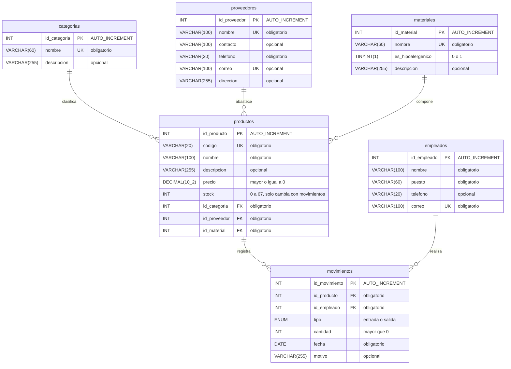

# Diagrama entidad-relación (completo)

Diagrama complementario con todos los atributos. Los nombres coinciden exactamente con `backend/database/script.sql`.

Notas:

- `UK` = restricción de unicidad (no se puede repetir el valor).
- En Mermaid no se puede escribir una coma dentro del tipo, por eso `DECIMAL(10,2)` aparece como `DECIMAL(10_2)`.
- Todas las llaves foráneas son `ON DELETE RESTRICT` (sin cascada).
