# Diagrama entidad-relación (completo)

Todas las tablas y atributos (los nombres coinciden con `backend/database/script.sql`). `DECIMAL(10,2)` se escribe `DECIMAL(10_2)` porque Mermaid no acepta comas en el tipo.

```mermaid
erDiagram
    usuarios ||--o{ auditoria : "id_usuario"
    usuarios ||--o{ clientes : "id_usuario"
    desafios_mfa ||--o{ codigos_verificacion : "id_desafio"
    usuarios ||--o{ codigos_verificacion : "id_usuario"
    usuarios ||--o{ configuracion : "id_usuario_actualizo"
    usuarios ||--o{ desafios_mfa : "id_usuario"
    detalle_ventas ||--o{ detalle_devoluciones : "id_detalle_venta"
    devoluciones ||--o{ detalle_devoluciones : "id_devolucion"
    productos ||--o{ detalle_solicitudes_abastecimiento : "id_producto"
    solicitudes_abastecimiento ||--o{ detalle_solicitudes_abastecimiento : "id_solicitud"
    productos ||--o{ detalle_ventas : "id_producto"
    ventas ||--o{ detalle_ventas : "id_venta"
    empleados ||--o{ devoluciones : "id_empleado"
    usuarios ||--o{ devoluciones : "id_usuario"
    ventas ||--o{ devoluciones : "id_venta"
    ventas ||--o{ movimientos : "id_venta"
    solicitudes_abastecimiento ||--o{ movimientos : "id_solicitud"
    productos ||--o{ movimientos : "id_producto"
    empleados ||--o{ movimientos : "id_empleado"
    devoluciones ||--o{ movimientos : "id_devolucion"
    categorias ||--o{ categorias : "id_categoria_padre"
    categorias ||--o{ productos : "id_categoria"
    productos ||--o{ producto_fotos : "id_producto"
    materiales ||--o{ productos : "id_material"
    proveedores ||--o{ productos : "id_proveedor"
    usuarios ||--o{ recuperacion_contrasena : "id_usuario_creador"
    usuarios ||--o{ recuperacion_contrasena : "id_usuario"
    usuarios ||--o{ sesiones : "id_usuario"
    usuarios ||--o{ solicitudes_abastecimiento : "id_usuario_creador"
    proveedores ||--o{ solicitudes_abastecimiento : "id_proveedor"
    usuarios ||--o{ solicitudes_abastecimiento : "id_usuario_recibio"
    empleados ||--o{ usuarios : "id_empleado"
    proveedores ||--o{ usuarios : "id_proveedor"
    clientes ||--o{ ventas : "id_cliente"
    clientes ||--o{ pedidos : "id_cliente"
    pedidos ||--o{ detalle_pedidos : "id_pedido"
    productos ||--o{ detalle_pedidos : "id_producto"
    ventas |o--o| pedidos : "id_venta"
    usuarios |o--o{ pedidos : "id_usuario_atendio"
    empleados ||--o{ ventas : "id_empleado"
    usuarios ||--o{ ventas : "id_usuario"
    categorias {
        INT id_categoria PK
        VARCHAR(60) nombre UK
        VARCHAR(255) descripcion
        INT id_categoria_padre FK
    }
    producto_fotos {
        INT id_foto PK
        INT id_producto FK
        VARCHAR(100) archivo UK
        SMALLINT orden
        TINYINT es_de_medidas
        DATETIME creada_en
    }
    proveedores {
        INT id_proveedor PK
        VARCHAR(100) nombre UK
        VARCHAR(100) contacto
        VARCHAR(20) telefono
        VARCHAR(100) correo UK
        VARCHAR(255) direccion
    }
    materiales {
        INT id_material PK
        VARCHAR(60) nombre UK
        TINYINT(1) es_hipoalergenico
        VARCHAR(255) descripcion
    }
    empleados {
        INT id_empleado PK
        VARCHAR(100) nombre
        VARCHAR(60) puesto
        VARCHAR(20) telefono
        VARCHAR(100) correo UK
    }
    productos {
        INT id_producto PK
        VARCHAR(20) codigo UK
        VARCHAR(100) nombre
        VARCHAR(255) descripcion
        DECIMAL(10_2) precio
        DECIMAL(10_2) costo_unitario
        INT stock
        INT id_categoria FK
        INT id_proveedor FK
        INT id_material FK
    }
    movimientos {
        INT id_movimiento PK
        INT id_producto FK
        INT id_empleado FK
        ENUM tipo
        INT cantidad
        DATE fecha
        VARCHAR(255) motivo
        INT id_venta FK
        INT id_devolucion FK
        INT id_solicitud FK
    }
    usuarios {
        INT id_usuario PK
        VARCHAR(100) correo UK
        VARCHAR(255) hash_contrasena
        ENUM rol
        TINYINT(1) activo
        TINYINT(1) correo_verificado
        VARCHAR(20) telefono
        TINYINT(1) telefono_verificado
        INT intentos_fallidos
        DATETIME bloqueado_hasta
        INT id_empleado FK
        INT id_proveedor FK
        DATETIME creado_en
        DATETIME ultimo_acceso
    }
    clientes {
        INT id_cliente PK
        INT id_usuario FK
        VARCHAR(100) nombre
        VARCHAR(255) direccion
        DATETIME creado_en
    }
    desafios_mfa {
        INT id_desafio PK
        INT id_usuario FK
        CHAR(64) hash_token UK
        DATETIME expira_en
        TINYINT(1) usado
        VARCHAR(45) ip
        DATETIME creado_en
    }
    codigos_verificacion {
        INT id_codigo PK
        INT id_usuario FK
        INT id_desafio FK
        ENUM proposito
        ENUM canal
        VARCHAR(100) destino
        CHAR(64) hash_codigo
        DATETIME expira_en
        INT intentos
        TINYINT(1) usado
        TINYINT(1) anulado
        DATETIME creado_en
    }
    sesiones {
        INT id_sesion PK
        INT id_usuario FK
        CHAR(64) hash_token UK
        DATETIME creada_en
        DATETIME ultima_actividad
        DATETIME expira_absoluta
        TINYINT(1) revocada
        VARCHAR(45) ip
        VARCHAR(255) agente
    }
    recuperacion_contrasena {
        INT id_recuperacion PK
        INT id_usuario FK
        ENUM proposito
        CHAR(64) hash_token UK
        DATETIME expira_en
        TINYINT(1) usado
        INT id_usuario_creador FK
        DATETIME creado_en
    }
    auditoria {
        BIGINT id_auditoria PK
        INT id_usuario FK
        VARCHAR(60) accion
        VARCHAR(500) detalle
        VARCHAR(45) ip
        DATETIME creado_en
    }
    pedidos {
        INT id_pedido PK
        CHAR(36) clave_idempotencia UK
        INT id_cliente FK
        ENUM estado
        DECIMAL(12_2) total
        VARCHAR(255) nota_cliente
        VARCHAR(255) motivo
        DATETIME creado_en
        DATETIME vence_en
        DATETIME confirmado_en
        DATETIME cerrado_en
        INT id_usuario_atendio FK
        INT id_venta FK "UK"
    }
    detalle_pedidos {
        INT id_detalle_pedido PK
        INT id_pedido FK
        INT id_producto FK
        INT cantidad
        DECIMAL(10_2) precio_unitario
        DECIMAL(12_2) subtotal
    }
    ventas {
        INT id_venta PK
        CHAR(36) clave_idempotencia UK
        INT id_usuario FK
        INT id_empleado FK
        INT id_cliente FK
        DECIMAL(12_2) total
        VARCHAR(255) nota
        DATETIME fecha
    }
    detalle_ventas {
        INT id_detalle_venta PK
        INT id_venta FK
        INT id_producto FK
        INT cantidad
        DECIMAL(10_2) precio_unitario
        DECIMAL(10_2) costo_unitario
        DECIMAL(12_2) subtotal
    }
    devoluciones {
        INT id_devolucion PK
        INT id_venta FK
        INT id_usuario FK
        INT id_empleado FK
        VARCHAR(255) motivo
        DECIMAL(12_2) total
        DATETIME fecha
    }
    detalle_devoluciones {
        INT id_detalle_devolucion PK
        INT id_devolucion FK
        INT id_detalle_venta FK
        INT cantidad
        DECIMAL(12_2) monto
    }
    solicitudes_abastecimiento {
        INT id_solicitud PK
        INT id_proveedor FK
        INT id_usuario_creador FK
        ENUM estado
        VARCHAR(255) nota_tienda
        VARCHAR(255) comentario_proveedor
        DATETIME creada_en
        DATETIME respondida_en
        INT id_usuario_recibio FK
        DATETIME recibida_en
    }
    detalle_solicitudes_abastecimiento {
        INT id_detalle_solicitud PK
        INT id_solicitud FK
        INT id_producto FK
        INT cantidad
    }
    configuracion {
        VARCHAR(50) clave PK
        VARCHAR(255) valor
        VARCHAR(255) descripcion
        DATETIME actualizado_en
        INT id_usuario_actualizo FK
    }
    migraciones_aplicadas {
        VARCHAR(100) nombre PK
        DATETIME aplicada_en
    }
```

Notas: todas las FK son RESTRICT (sin cascada); por eso el backend borra las fotos de un producto antes de borrar el producto. `categorias.id_categoria_padre` apunta a la misma tabla (subcategorías, solo dos niveles). Las relaciones con `usuarios` que son 0..1 (cliente, empleado, proveedor) usan índices UNIQUE para que una persona tenga como máximo una cuenta.
