# Diagrama entidad-relación (simple)

Diagrama principal: solo tablas, llaves primarias (PK), llaves foráneas (FK) y relaciones. Arriba la versión 1 (inventario); abajo lo nuevo de la versión 2.

```mermaid
erDiagram
    usuarios ||--o{ auditoria : "id_usuario"
    usuarios ||--o{ clientes : "id_usuario"
    desafios_mfa ||--o{ codigos_verificacion : "id_desafio"
    usuarios ||--o{ codigos_verificacion : "id_usuario"
    usuarios ||--o{ configuracion : "id_usuario_actualizo"
    usuarios ||--o{ desafios_mfa : "id_usuario"
    detalle_ventas ||--o{ detalle_devoluciones : "id_detalle_venta"
    devoluciones ||--o{ detalle_devoluciones : "id_devolucion"
    productos ||--o{ detalle_solicitudes_abastecimiento : "id_producto"
    solicitudes_abastecimiento ||--o{ detalle_solicitudes_abastecimiento : "id_solicitud"
    productos ||--o{ detalle_ventas : "id_producto"
    ventas ||--o{ detalle_ventas : "id_venta"
    empleados ||--o{ devoluciones : "id_empleado"
    usuarios ||--o{ devoluciones : "id_usuario"
    ventas ||--o{ devoluciones : "id_venta"
    ventas ||--o{ movimientos : "id_venta"
    solicitudes_abastecimiento ||--o{ movimientos : "id_solicitud"
    productos ||--o{ movimientos : "id_producto"
    empleados ||--o{ movimientos : "id_empleado"
    devoluciones ||--o{ movimientos : "id_devolucion"
    categorias ||--o{ categorias : "id_categoria_padre"
    categorias ||--o{ productos : "id_categoria"
    productos ||--o{ producto_fotos : "id_producto"
    materiales ||--o{ productos : "id_material"
    proveedores ||--o{ productos : "id_proveedor"
    usuarios ||--o{ recuperacion_contrasena : "id_usuario_creador"
    usuarios ||--o{ recuperacion_contrasena : "id_usuario"
    usuarios ||--o{ sesiones : "id_usuario"
    usuarios ||--o{ solicitudes_abastecimiento : "id_usuario_creador"
    proveedores ||--o{ solicitudes_abastecimiento : "id_proveedor"
    usuarios ||--o{ solicitudes_abastecimiento : "id_usuario_recibio"
    empleados ||--o{ usuarios : "id_empleado"
    proveedores ||--o{ usuarios : "id_proveedor"
    clientes ||--o{ ventas : "id_cliente"
    clientes ||--o{ pedidos : "id_cliente"
    pedidos ||--o{ detalle_pedidos : "id_pedido"
    productos ||--o{ detalle_pedidos : "id_producto"
    ventas |o--o| pedidos : "id_venta"
    usuarios |o--o{ pedidos : "id_usuario_atendio"
    empleados ||--o{ ventas : "id_empleado"
    usuarios ||--o{ ventas : "id_usuario"
    categorias {
        INT id_categoria PK
        INT id_categoria_padre FK
    }
    producto_fotos {
        INT id_foto PK
        INT id_producto FK
    }
    proveedores {
        INT id_proveedor PK
    }
    materiales {
        INT id_material PK
    }
    empleados {
        INT id_empleado PK
    }
    productos {
        INT id_producto PK
        INT id_categoria FK
        INT id_proveedor FK
        INT id_material FK
    }
    movimientos {
        INT id_movimiento PK
        INT id_producto FK
        INT id_empleado FK
        INT id_venta FK
        INT id_devolucion FK
        INT id_solicitud FK
    }
    usuarios {
        INT id_usuario PK
        INT id_empleado FK
        INT id_proveedor FK
    }
    clientes {
        INT id_cliente PK
        INT id_usuario FK
    }
    desafios_mfa {
        INT id_desafio PK
        INT id_usuario FK
    }
    codigos_verificacion {
        INT id_codigo PK
        INT id_usuario FK
        INT id_desafio FK
    }
    sesiones {
        INT id_sesion PK
        INT id_usuario FK
    }
    recuperacion_contrasena {
        INT id_recuperacion PK
        INT id_usuario FK
        INT id_usuario_creador FK
    }
    auditoria {
        INT id_auditoria PK
        INT id_usuario FK
    }
    pedidos {
        INT id_pedido PK
        INT id_cliente FK
        INT id_venta FK
        INT id_usuario_atendio FK
    }
    detalle_pedidos {
        INT id_detalle_pedido PK
        INT id_pedido FK
        INT id_producto FK
    }
    ventas {
        INT id_venta PK
        INT id_usuario FK
        INT id_empleado FK
        INT id_cliente FK
    }
    detalle_ventas {
        INT id_detalle_venta PK
        INT id_venta FK
        INT id_producto FK
    }
    devoluciones {
        INT id_devolucion PK
        INT id_venta FK
        INT id_usuario FK
        INT id_empleado FK
    }
    detalle_devoluciones {
        INT id_detalle_devolucion PK
        INT id_devolucion FK
        INT id_detalle_venta FK
    }
    solicitudes_abastecimiento {
        INT id_solicitud PK
        INT id_proveedor FK
        INT id_usuario_creador FK
        INT id_usuario_recibio FK
    }
    detalle_solicitudes_abastecimiento {
        INT id_detalle_solicitud PK
        INT id_solicitud FK
        INT id_producto FK
    }
    configuracion {
        VARCHAR clave PK
        INT id_usuario_actualizo FK
    }
    migraciones_aplicadas {
        VARCHAR nombre PK
    }
```

## Cómo leer el diagrama

- `||--o{` significa "uno a muchos": por ejemplo, una venta tiene muchas líneas en `detalle_ventas` y cada línea pertenece a una sola venta.
- **Inventario (v1):** categorías, proveedores y materiales clasifican a los productos; cada movimiento es de un producto y lo registra un empleado.
- **Pedidos (migración 008):** un cliente hace pedidos (`pedidos` + `detalle_pedidos`); mientras están pendientes o confirmados apartan unidades. Al entregarse, el pedido apunta a la venta que se registró (`id_venta`).
- **Subcategorías y fotos (migración 006):** una categoría puede estar dentro de otra (`categorias` se relaciona consigo misma por `id_categoria_padre`, por ejemplo Crochet > Peluches); cada producto tiene de 0 a 8 fotos en `producto_fotos` (solo el nombre del archivo; la imagen está en `backend/uploads/productos`).
- **Cuentas:** una cuenta (`usuarios`) puede ser de un cliente (`clientes`), de un empleado o de un proveedor; nunca repite sus datos.
- **Seguridad:** desafíos MFA, códigos, sesiones, enlaces de recuperación/invitación y auditoría cuelgan de `usuarios`.
- **Ventas:** venta → detalle; devolución → detalle de devolución (apunta a la línea vendida). Los movimientos pueden apuntar a la venta, la devolución o la solicitud que los creó.
- **Abastecimiento:** solicitud a un proveedor → detalle con productos y cantidades.

Para ver todos los atributos, abra [diagrama-completo.md](diagrama-completo.md).
