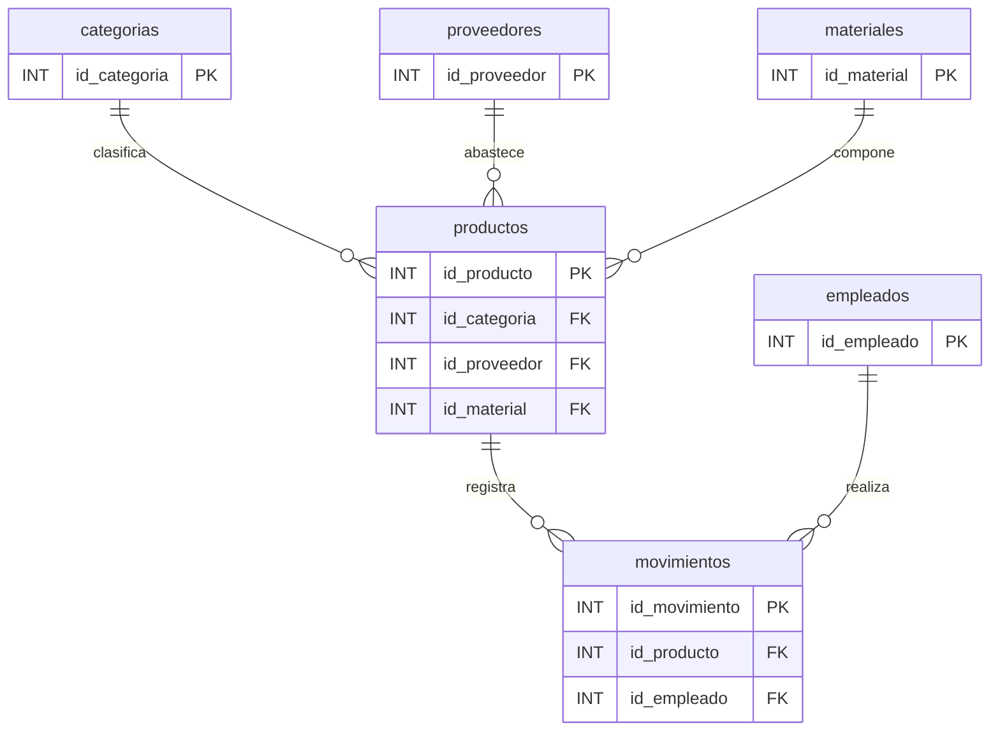

# Diagrama entidad-relación (simple)

Diagrama principal del proyecto: solo tablas, llaves primarias (PK), llaves foráneas (FK) y relaciones.

## Cómo leer las líneas

- `||--o{` significa "uno a muchos": una categoría puede tener cero o muchos productos, y cada producto pertenece a exactamente una categoría.
- Lo mismo para proveedores, materiales, productos → movimientos y empleados → movimientos.

Para ver todos los atributos, abra [diagrama-completo.md](diagrama-completo.md).
